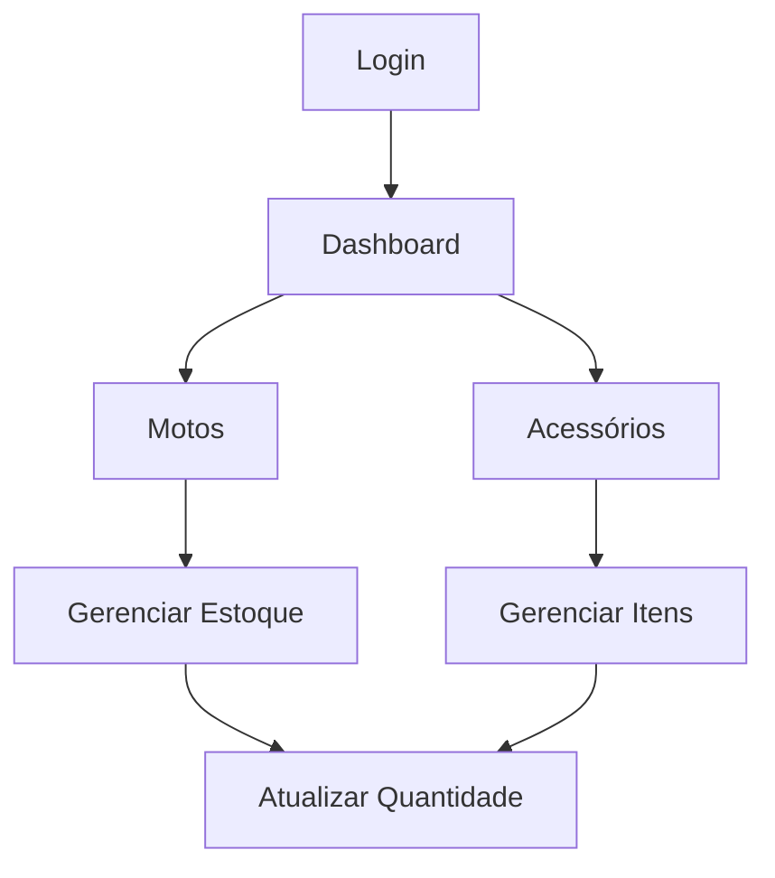

# 🏍️ Stock Moto

<p align="center">
  
  
  
  
</p>

<p align="center">
  <b>Aplicativo mobile para gerenciamento de estoque de motos e acessórios</b><br/>
  Simples, intuitivo e focado em produtividade 📦
</p>

---


🔗 **Protótipo interativo:**
https://www.figma.com/proto/8mc9326n5v5aGeKzwOPnt0/APP-STOCK-MOTO

---

## 🧠 Sobre o projeto

O **Stock Moto** foi criado para resolver problemas comuns de controle de estoque em oficinas e lojas de motocicletas.

Com uma interface moderna e intuitiva, o app permite:

* Organizar produtos
* Controlar quantidades
* Visualizar estoque rapidamente
* Gerenciar acessórios

---

## ✨ Funcionalidades

### 🔐 Autenticação

* Login
* Criar conta
* Recuperação de senha

### 🏠 Dashboard

* Acesso rápido às categorias
* Navegação simples e direta

### 📦 Estoque de Motos

* Separação por marcas:

  * Honda
    
* Controle de quantidade
* Atualização em tempo real

### 🛠️ Acessórios

* Categorias:

  * Capacetes
  * Baús
    
* Gestão individual de itens

### ➕ Cadastro

* Criação de novos produtos
* Formulários completos

### ⚠️ Alertas

* Estoque baixo
* Indicadores visuais

### 👤 Perfil & ⚙️ Configurações

* Dados do usuário
* Preferências do sistema

---

## 🧩 Fluxo do App



---

## 🎨 Design

* 🌙 Tema escuro moderno
* 🟧 Destaque em laranja
* 📱 Mobile-first
* 🔄 Navegação intuitiva
* 🧩 Componentização

---

## 🛠️ Tecnologias

> (planejadas para desenvolvimento)

* React Native
* Firebase
* Figma (UI/UX)
* API (NoSQL)
* Spring Boot

---

## 📌 Status

🚧 Projeto em fase de prototipação

---

## 🧪 Testes automatizados (E2E)

Os testes de ponta a ponta usam o [Playwright](https://playwright.dev) sobre o build web do app e ficam em `StockMoto/tests/`. Eles **nunca acessam o Firebase de produção** (veja [Proteção contra tráfego externo](#proteção-contra-tráfego-externo)).

### Instalação

Todos os comandos são executados dentro da pasta `StockMoto/`:

```bash
cd StockMoto
```

Instale as dependências exatamente como no `package-lock.json`:

```bash
npm ci
```

Instale o navegador usado nos testes (Chromium):

```bash
npx playwright install chromium
```

Para rodar nos três navegadores (Chromium, Firefox e WebKit), instale todos:

```bash
npx playwright install
```

No Linux, se faltarem bibliotecas do sistema, use `npx playwright install --with-deps`.

### Execução

Somente Chromium (recomendado no dia a dia):

```bash
npm run test:e2e:chromium
```

Nos três navegadores:

```bash
npm run test:e2e
```

Os dois scripts rodam o **ESLint antes** dos testes. Em seguida, o Playwright:

1. gera um build web próprio dos testes em `dist-e2e/` (o `dist/` normal não é alterado);
2. confere que esse build só aponta para o projeto fictício `demo-stockmoto`; se não, nada é executado;
3. serve o build na porta **8935**, que precisa estar livre. Um servidor que já esteja nessa porta **não é reaproveitado**: a execução falha avisando.

O relatório HTML fica disponível depois da execução:

```bash
npx playwright show-report
```

> `npx playwright test` também funciona, mas pula o ESLint. Prefira os scripts `npm run`.

### Variáveis de ambiente

Nenhuma variável precisa ser definida manualmente.

| Variável | Quem define | Para quê |
|---|---|---|
| `EXPO_PUBLIC_FIREBASE_AMBIENTE=teste` | o `webServer` do `playwright.config.ts`, só no build dos testes | troca o Firebase pelo projeto fictício `demo-stockmoto`. **Nunca defina em builds normais**: sem ela, o app usa a configuração de produção, como sempre |
| `EXPO_NO_TELEMETRY=1` | o `webServer` | desliga a telemetria do Expo CLI durante os testes |
| `CI=1` | opcional, em integração contínua | 1 worker, 2 novas tentativas por falha e relatório em lista |

### Proteção contra tráfego externo

Cada camada abaixo, sozinha, já impede que os testes alcancem o Firebase de produção:

1. **Projeto Firebase fictício.** O build dos testes usa `demo-stockmoto` e uma chave falsa. O script `tests/support/verificar-build-teste.mjs` interrompe a execução se encontrar um `projectId` que não comece com `demo-` ou uma chave real do Google (`AIza...`).
2. **Proxy inexistente.** O navegador (incluindo os serviços de segundo plano) e as requisições de API do Playwright passam por um proxy em `127.0.0.1:9`, que não existe. Só o servidor local dos testes é acessado diretamente. Service workers ficam bloqueados.
3. **Fixtures de rede (`tests/support/fixtures.ts`).**
   - Todo contexto do navegador é protegido: o padrão, os criados com `browser.newContext()`/`newPage()`, novas abas e navegadores lançados manualmente.
   - O Firebase Auth é respondido por um mock local, e o Firestore recebe uma falha local, como se o aparelho estivesse offline.
   - Qualquer outra requisição HTTP/HTTPS, XHR, `fetch`, imagem, beacon ou WebSocket, e qualquer chamada do fixture `request`, `page.request` ou `context.request` para fora do servidor de testes, é bloqueada e **faz o teste falhar**.
   - Uma chamada ao Auth com chave que não seja a de teste também reprova o teste.

O arquivo `tests/protecao-rede.spec.ts` testa essas proteções com tentativas deliberadas para um domínio `.invalid`, que nunca existe.

**Ao escrever novos testes**, importe sempre de `./support/fixtures`:

```ts
import { test, expect } from './support/fixtures';
```

O ESLint bloqueia, dentro de `tests/`, importar `test` de `@playwright/test`, importar `playwright`, `playwright/test` ou `playwright-core`, e usar `require()` ou `import()` dinâmico do Playwright. Tipos e utilitários (`expect`, `devices`, `type Page`) continuam permitidos.

---

## 🚀 Roadmap

* [ ] Transformar design em código
* [ ] Criar API de produtos
* [ ] Implementar autenticação real
* [ ] Notificações de estoque
* [ ] Relatórios avançados

---

